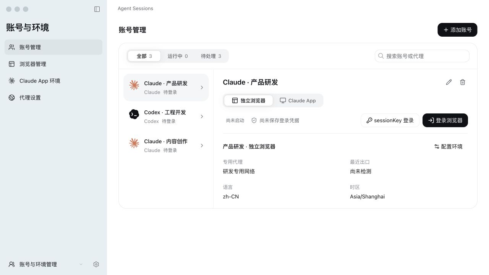
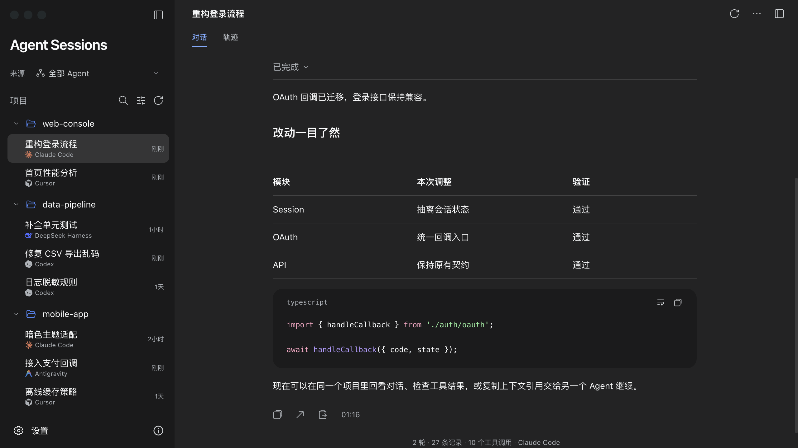

<div align="center">
  
  <h1>Agent Sessions</h1>
  <p><a href="README.md">简体中文</a> · <strong>English</strong></p>
  <p><strong>Your agent sessions and accounts, in one workspace.</strong></p>
  <p>A local AI workspace for reviewing agent work and organizing accounts with independent environments.</p>
  <p>Session management · Account management · Skill installation management</p>
</div>

[](docs/media/account-workspace.jpg)

> The current account management interface, shown with fictional accounts, environments, and proxy settings. Click the screenshot to view the original. The demo uses Chinese UI text.

Agent Sessions centers on two workspaces: **session management** and **account management**. One brings local conversations and tool traces from different agents together; the other organizes Claude/Codex accounts and their independent runtime environments. A supporting Skill workspace installs and maintains the bundled `agent-sessions` Skill.

| Workspace | What it does |
| --- | --- |
| **Sessions** | Browse conversations by project, search history, inspect tool traces, and copy context references |
| **Accounts** | Organize Claude/Codex accounts, bind independent browser or Claude App environments, configure dedicated proxies, and view runtime state |
| Skills | Install `agent-sessions` into local agents and manage updates, links, backups, and restores |

Choose a workspace on the start page or switch from the bottom of the sidebar. Settings are shared across workspaces.

## Sessions: revisit discussions and inspect the work

A project may use Codex, Claude Code, and Cursor together. Browse their histories in one project list while keeping the original source files.

- **Projects and search:** browse by project and source; search titles, projects, and visible conversation text.
- **Conversations and traces:** read Markdown, code, tables, and available images. Switch to the timeline to inspect tool arguments, results, and original records.
- **Incremental sync:** follow messages and tool records already written to local history. Long content loads in pages.
- **Organization and handoff:** pin, rename, archive, adjust project assignments, and copy a context reference for a whole session or from a specific message onward.

### Supported session sources

| Source | Current integration |
| --- | --- |
| Codex Desktop / CLI | Local sessions, visible conversations, tool records, and available attachments; labels for non-interactive exec tasks and subagents |
| Claude Code | Shared Desktop/CLI session content, shown together and read from the current branch |
| Cursor | Local desktop Agent/Composer session databases |
| Antigravity Desktop | Local summaries, saved conversation content, and available execution records |
| Antigravity CLI | A local source separate from the desktop app |
| DeepSeek Harness | Local JSONL/Zstandard-compressed logs, work steps, and tool records |

Available views depend on what each agent actually saves. Common source directories are discovered automatically and can be changed in Settings. See [Desktop app and source details](references/desktop-app.md) for formats and reading boundaries.

Pass a context reference to a later agent task so it can read the relevant outline, original messages, and tool evidence. The receiving agent needs access to files on the same computer. References provide historical context; they do not transfer running state or carry over authorization. See [Context reading and recovery](references/context-recovery.md).

<details>
<summary>View a conversation example</summary>

[](docs/media/conversation-dark.png)

</details>

## Accounts: keep each account tied to its environment

Configure independent browsers for Claude/Codex accounts. Claude accounts can also bind an official **Claude App** environment. Switch the client in account details, inspect runtime and stored-credential state, and open the corresponding window.

- **Separate accounts and environments:** bind browser and Claude App profiles, with independent data directories, language, time zone, and proxy settings.
- **Open and switch:** open, focus, or stop an environment from its account. Running environments retain their own login state and configuration.
- **Dedicated proxies:** add HTTP/SOCKS endpoints or import subscriptions and Clash configurations. The app manages a separate Mihomo process without changing the system proxy.
- **On-demand checks:** inspect proxy, egress, and environment results. Browser and App checks remain distinct, with configured preflight rules applied at launch.
- **Components:** install, update, and remove Fingerprint Chromium, Mihomo, and official Claude App from Settings. Components download on demand; environment configuration is stored separately from program files.

Accounts use the respective service's official login flow. For platform support, isolation boundaries, login behavior, and validation status, see:

- [Accounts and independent environments](references/account-environments.md)
- [Dedicated proxies](references/dedicated-proxies.md)
- [Platforms and components](references/runtime-components.md)
- [Local Skill and plugin inheritance in Claude App](references/claude-plugin-inheritance.md)

## Skills: maintain local installation entries

The current installation target is the bundled **`agent-sessions` Skill**, which lets agents read local history through references. Deploy it to supported local Codex, Claude Code, Cursor, Antigravity, and other entries, using linked installs or independent copies. Manage updates, broken-link repairs, removal, and backup restores.

Operations show actual paths and a change plan before execution, then re-read the installed files. Shared entries identify affected consumers. Files being available and an agent having loaded them are tracked separately; confirm loading in a new agent session. See [Skill installation management](references/skill-management-ui.md).

## Local data and runtime boundaries

- Source histories are read-only. Names, archives, project organization, and reading preferences are stored separately.
- Account configuration, environment settings, and independent data directories stay local. Reading history does not require uploading conversations; login, component downloads, and on-demand network checks connect to the relevant services.
- The interface and backend run locally, with the service bound to loopback only.
- Runtime connection sampling can detect anomalies and stop environments. It is not an operating-system network block; coverage depends on validation for each platform.

## Get started

### Build the desktop app

Requires **Node.js 22.12+, Python 3.10+, Rust/Cargo**, and the [Tauri prerequisites](https://v2.tauri.app/start/prerequisites/) for the target system.

```bash
git clone --branch main https://github.com/healwrap/agent-sessions-manager.git
cd agent-sessions-manager
npm ci
npm run desktop:build
```

The package includes the interface and Python backend; the built app needs no separately started service. macOS outputs:

- `desktop/target/release/bundle/macos/Agent Sessions.app`
- `desktop/target/release/bundle/dmg/Agent Sessions_0.1.0_aarch64.dmg` (Apple Silicon)

The macOS build has been run locally. Windows/Linux need building and validation on their own systems. Distribution signing and notarization are not configured. See [Desktop build details](references/desktop-app.md#构建).

<details>
<summary>Run as a local web app</summary>

```bash
python3 -m venv .venv
source .venv/bin/activate
python -m pip install -r requirements.txt
npm ci
npm run build:ui
python scripts/trajectory_server.py --port 8766
```

Open [http://127.0.0.1:8766](http://127.0.0.1:8766). In Windows PowerShell, activate with `.venv\Scripts\Activate.ps1`. Native window controls and opening local links with default applications require the desktop app.

</details>

### Update the source

Preserve local work, then update `main` and rebuild:

```bash
git switch main
git pull --ff-only origin main
npm ci
npm run desktop:build
```

## Session feature video

The existing 30-second promo shows an earlier version's conversation browsing, tool traces, and context handoff. See the current interface and sections above for account and Skill management.

<details>
<summary>▶ Expand to play the session feature demo</summary>

https://github.com/user-attachments/assets/c2cfc3a9-45bc-493d-b858-1181e6496db1

30 seconds · 1920 × 1080 · With music · [Download MP4](https://github.com/healwrap/agent-sessions-manager/raw/refs/heads/main/docs/media/agent-sessions-landscape.mp4)

</details>

## Development and contributions

React, TypeScript, Vite, and Tailwind CSS frontend; Python backend; Tauri desktop shell. Sources use a shared plugin interface, and management pages reuse common UI components.

- [Project structure, commands, and validation](references/development.md)
- [Source plugin interface](references/source-plugins.md)
- [Conversation and trajectory conventions](references/trajectory-ui.md)
- [Issues and suggestions](https://github.com/healwrap/agent-sessions-manager/issues)

Use demo data or remove personal conversations and credentials before sharing issues or screenshots. Detailed reference documents are currently in Chinese.

## Credits

Parts of the interface and trajectory styles reference DeepSeek Harness, with its MIT license preserved in [harness-license.txt](frontend/public/harness-license.txt). Other dependency and third-party icon licenses and sources are retained with the code. See [Media notes](docs/media/README.md) for the app icon and promotional assets.
