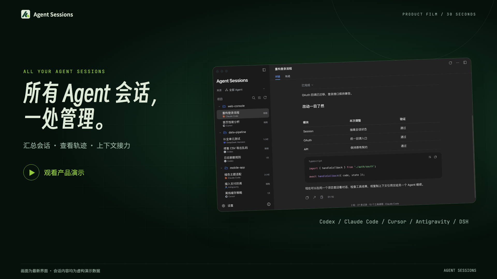
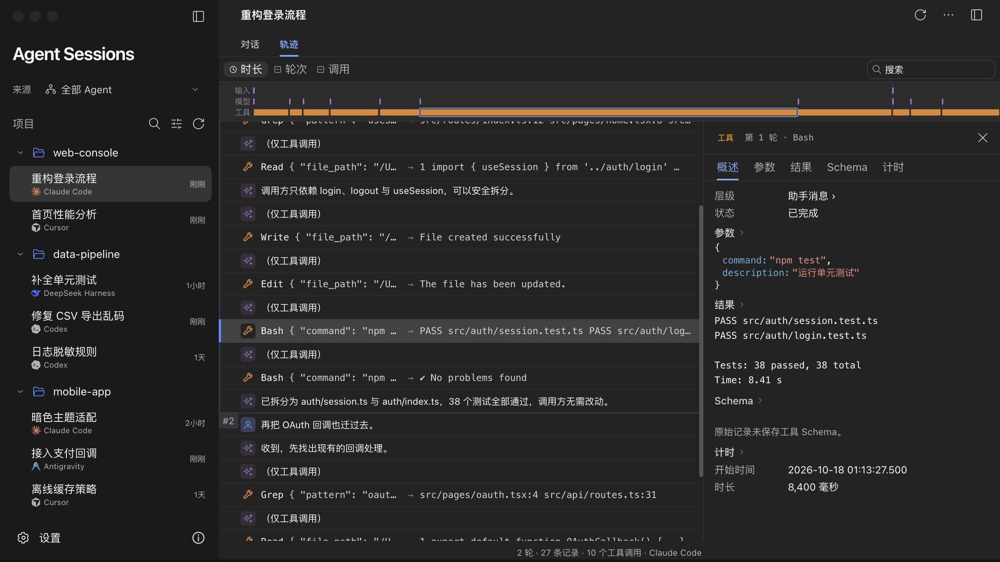
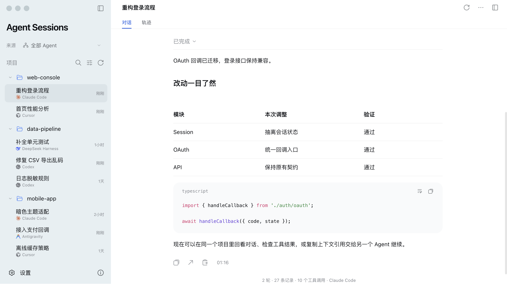
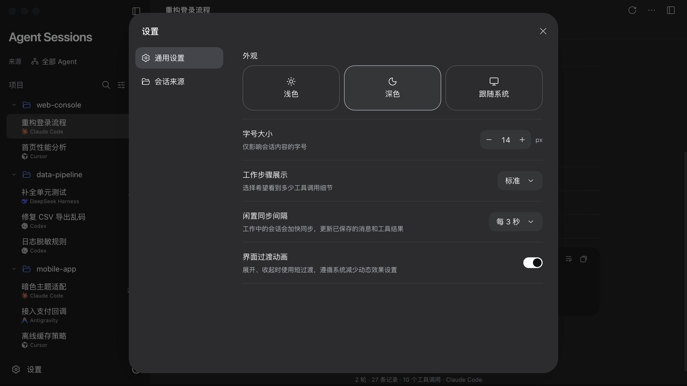

<div align="center">
  
  <h1>Agent Sessions</h1>
  <p><a href="README.md">简体中文</a> · <strong>English</strong></p>
  <p><strong>All your agent sessions, in one place.</strong></p>
  <p>Bring conversations and tool traces from different tools back to the same project.</p>
  <p>Local-first · Read-only history · Context handoff</p>
</div>

## Meet Agent Sessions in 30 seconds



<details>
<summary>▶ Expand to play the 30-second promo</summary>

https://github.com/user-attachments/assets/c2cfc3a9-45bc-493d-b858-1181e6496db1

</details>

30 seconds · 1920 × 1080 · With music · [Download MP4](https://github.com/healwrap/agent-sessions-manager/raw/refs/heads/main/docs/media/agent-sessions-landscape.mp4)

> The video and screenshots show the current interface using fictional demo sessions. Full-resolution screenshots are 2560 × 1440; click any image to view it. The demo uses Chinese UI text.

## Spend less time hunting for sessions

You write code with Codex, investigate a bug with Claude Code, then polish the interface in Cursor. The project moves forward, but its conversations stay scattered across tools.

Agent Sessions is a local session manager that brings those sources into one project list. Revisit conversations, inspect what an agent did, and reference relevant history in your next task.

| What you need | How Agent Sessions helps |
| --- | --- |
| Find a past discussion | Browse by project and source; search titles, projects, and visible conversation text |
| Read a long conversation | View Markdown, highlighted code, tables, available image previews, and expandable work steps |
| Understand what an agent did | Switch between conversation and trajectory views to inspect tool arguments, results, and original records |
| Follow ongoing work | Incrementally sync messages and tool records already written to local history by the source agent |
| Continue with another agent | Copy a context reference for an entire session or from a specific message onward |
| Organize your workspace | Keep pins, custom names, archives, and project assignments in separate app settings |

## See the conversation and the work behind it

### Sessions organized by project

Browse multiple sources in one sidebar while keeping each session's source visible. Code blocks, tables, and collapsible work steps make past conversations easier to read.

[](docs/media/conversation-dark.png)

### Follow every step

The trajectory view places messages and tool records on one timeline. Select a record to inspect its arguments and results, or jump to the corresponding point from a conversation message.

[](docs/media/trajectory-dark.png)

### Read the way you prefer

Choose a light, dark, or system theme, adjust the text size, and control how work steps appear. Settings save automatically.

| Light conversation view | General settings |
| :---: | :---: |
| [](docs/media/conversation-light.png) | [](docs/media/settings-dark.png) |

## Hand off context without starting over

1. Choose **Copy context reference** in a session menu to reference the entire session, or use the button beside a message to reference that message and everything after it.
2. Paste the reference into your next agent task and explain what you want to continue.
3. The receiving agent reads the relevant outline, original messages, and tool evidence as needed, then continues the task.

References use local read-only commands. The receiving agent must be able to access the history files on the same computer. A reference provides historical context; it does not transfer a running agent's state or carry over authorization from earlier tasks. See [Context reading and recovery](references/context-recovery.md) for details (in Chinese).

## Supported sources

| Source | Current integration |
| --- | --- |
| Codex | Local Desktop / CLI sessions, visible conversations, tool records, and available attachments |
| Claude Code | Shared Desktop and CLI session content, shown together and read from the current conversation branch |
| Cursor | Local desktop Agent / Composer session databases |
| Antigravity Desktop | Local session summaries, saved conversation content, and available execution records |
| Antigravity CLI | A local session source separate from the desktop app |
| DeepSeek Harness | Local JSONL and Zstandard-compressed logs, work steps, and tool records |

Common source directories are discovered automatically and can be changed in Settings. Each agent saves different data, so the available views depend on its local records. Sessions with only summaries or missing conversation content show an explicit empty state. See [Desktop app and source details](references/desktop-app.md) for formats, attachment support, and reading boundaries (in Chinese).

## Your history stays on your computer

- History files are read-only. Original fields are preserved, and source sessions are never rewritten.
- Custom names, archives, project organization, and preferences are stored separately.
- The interface and backend run locally. The service listens only on the loopback interface; reading history does not require uploading conversations.
- Long conversations load in pages, and tool results are read on demand. Live sync covers content already saved to local records.

## Get started

### Run locally

Requires **Node.js 22.12+** and **Python 3.10+**.

```bash
git clone https://github.com/healwrap/agent-sessions-manager.git
cd agent-sessions-manager
npm ci
python3 -m venv .venv
source .venv/bin/activate
python -m pip install -r requirements.txt
npm run build:ui
python scripts/trajectory_server.py --port 8765
```

Open [http://127.0.0.1:8765](http://127.0.0.1:8765). In Windows PowerShell, activate the environment with `.venv\Scripts\Activate.ps1`.

### Build the desktop app

Install the [Tauri prerequisites](https://v2.tauri.app/start/prerequisites/) for your target system, along with Rust/Cargo, Node.js, and Python. Then run from the repository root:

```bash
npm ci
npm run desktop:build
```

The desktop package includes its backend, so the built app does not need a separately launched Python service or browser. The macOS app has been built and run locally. Windows and Linux builds require validation on their respective systems. Distribution signing is not configured yet. See [Desktop build details](references/desktop-app.md#构建) for build outputs and usage notes (in Chinese).

### Let an agent read history on demand

The repository also includes the [Agent Sessions Skill](SKILL.md) and a context-reading CLI. The reading entry points do not require a frontend build. See [Context reading and recovery](references/context-recovery.md) for the Codex-specific workflow (in Chinese).

## Development and contributions

The frontend uses React, TypeScript, Vite, and Tailwind CSS; the backend uses Python; the desktop shell uses Tauri. New sources integrate through a shared plugin interface.

- [Project structure, development commands, and validation](references/development.md) (Chinese)
- [Source plugin interface](references/source-plugins.md) (Chinese)
- [Conversation and trajectory display conventions](references/trajectory-ui.md) (Chinese)
- [Report an issue or suggest an improvement](https://github.com/healwrap/agent-sessions-manager/issues)

Use demo records or remove personal conversations and credentials before sharing an issue or screenshot.

## Acknowledgments

Parts of the interface and trajectory styling draw on DeepSeek Harness. Its MIT license is preserved in [harness-license.txt](frontend/public/harness-license.txt). Other dependency and icon licenses remain with the source. See [Demo media notes](docs/media/README.md) for assets, fonts, and production details (in Chinese).
